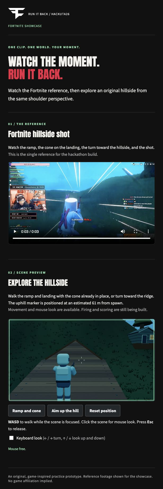
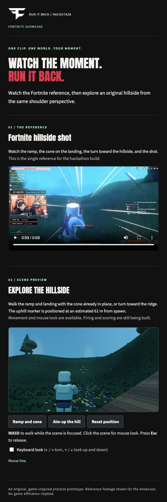
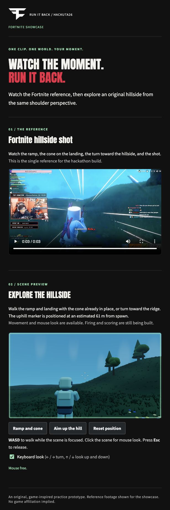
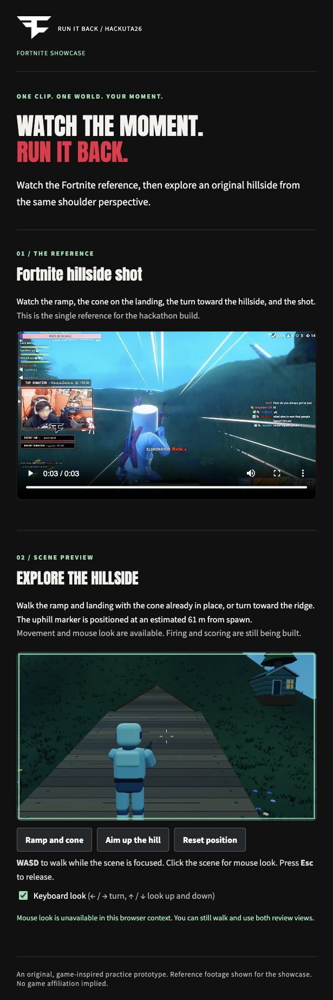

# PR #21 Fortnite preview release verification

**Status: released and Render verified.**

- Release PR: https://github.com/Kx007-del/hackuta26/pull/22 (merged into `build/five-agent-h26`).
- Reviewed implementation: `cad1e9cf5ffe89b92c22b24de1a1c677374813e7` (PR #21).
- Reviewed test / combined candidate: `6a7ed3f6d450a2a7a469acbb95ae547271dfa426` on `work/claude-2/pr21-cad1e9c-tests`.
- **Merged SHA = deployed SHA: `c99491dc1fe4915b961de4804dfdc62245abad1c`.**
- Live site: https://hackuta26.onrender.com/
- Render deploy: `dep-dbskhvuc6qcc739efdo0`, terminal status `live`.
- Actual public `/api/health`: HTTP 200, `{"ok":true,"service":"run-it-back","commit":"c99491dc1fe4915b961de4804dfdc62245abad1c"}`. Saved in [health.json](health.json).

## Review and integration

Read [Claude 1's revised implementation review](https://github.com/Kx007-del/hackuta26/pull/21#issuecomment-6889879152), [Claude 2's exact-head checks](https://github.com/Kx007-del/hackuta26/pull/21#issuecomment-6889900265), and [Claude 1's updated-test review](https://github.com/Kx007-del/hackuta26/pull/21#issuecomment-6889924168). The former C1 collision and C2 keyboard-look gaps are resolved. The superseded test branch was excluded; the updated test head resolves T1.

Verified the test head has the implementation as its only parent and adds only `tests/h26-hillside-scene.test.ts`. Neither head was already in the integration branch. Used the descendant directly as the candidate, avoiding duplicate implementation integration. No production edits or test revisions were introduced. PR #21 is now reported merged by GitHub through this release's ancestry. Existing work, branches and ignored logs preserved.

## Exact-candidate validation

| Check | Actual result | Difference from expected baseline |
| --- | --- | --- |
| `npm test` | 115 passed; 0 failed/skipped/todo | None |
| `npm run team:test` | 9 passed; 0 failed/skipped/todo | None |
| `npm run build` | TypeScript + Vite production build passed | None |
| `git diff --check` | Clean | None |
| Required GitHub checks | Both Build and tests checks passed before merge | None |
| Merged-commit GitHub CI | Build and tests passed | None |

Candidate CI: [push check](https://github.com/Kx007-del/hackuta26/actions/runs/43682807422/job/132716872107), [PR check](https://github.com/Kx007-del/hackuta26/actions/runs/43682811048/job/132716883037). [Merged-commit CI](https://github.com/Kx007-del/hackuta26/actions/runs/43682897392/job/132717146458) also passed.

The build produced `HillsidePreview-DuEJCj9Z.js`: 531.70 kB, 139.82 kB gzip. Full local output: [application tests](application-tests.log), [relay tests](relay-tests.log), [production build](production-build.log). Relay verification used the existing mock-provider tests only; no automated dispatch or worker listener was started.

## Render verification

Updated the existing service `srv-dbsf9ujl550s738a7seg` in the previously human-confirmed workspace `tea-d80cdkrtqb8s7382h57g`. Its free plan, storage, build/start commands and source branch were not changed. Auto-deploy remains enabled on commit.

Deployment observation differs from the expected automatic path: after two minutes, Render had no deploy or build events for the merge, although merged-commit CI was green. The prior deployment was still live. Issued one manual deploy trigger for the missing release, then followed its exact deploy ID to `live` and independently checked the public health commit. No second deploy trigger or service configuration change was made.

## Hosted browser checks

Performed against the live site only after the health commit matched. Browser: in-app browser, viewport 615 × 1846 CSS pixels. Evidence files are original full-page JPEG captures. [Raw browser observations](browser-observations.json) include video metadata, pointer-lock state and logs.

| Hosted check | Observed result |
| --- | --- |
| Fixed video | `/showcase/fortnite-reference.mp4` decoded at 1920 px wide, readyState 4, duration 3.103633 s. Clicking play advanced from 0 to 3.103633 s and ended normally. |
| Hillside preview | START PRACTICE PREVIEW loaded the canvas with shoulder-view mannequin, wooden ramp/landing, static cone, hillside and hut. |
| Ramp and cone review | Restored the ramp framing with the preplaced cone at the landing. |
| Aim up the hill review | Showed the clear slope, skyline tree pair and small ramp edge at lower right. |
| Movement | Holding W for 700 ms while the canvas was focused visibly advanced the player along the ramp. Screenshot captured after movement. |
| Keyboard look | Enabling the labelled checkbox and holding Left for 700 ms visibly turned the view. Disabled state was also exercised/captured; the checkbox was restored off at the end. |
| Reset with cone | Reset after walking returned to the original ramp-and-cone view. **Initial and post-walk reset full-page screenshot files are byte-identical**, SHA-256 `c37ccedc1912d43cbad0ca211cb88682449fd7025019fe13ce7dc5a01a92d308`. A further reset after review/keyboard/mouse-capture attempts was also captured. |
| Browser warnings/errors | None recorded throughout hosted video/preview/control checks. |

### Mouse capture and Escape — separate limitation

Real pointer lock was refused in this browser context. The page displayed: “Mouse look is unavailable in this browser context. You can still walk and use both review views.” `document.pointerLockElement` was null. Escape without a lock produced no error and left it null. **Actual captured mouse movement and Escape releasing an acquired lock are not verified by this release browser check.** This is separate from the passing keyboard-look/movement/reset checks. Source-level Esc/cleanup coverage is present in Claude 2's reviewed tests; it is not substituted for a real pointer-lock check.

## Screenshots

### Ramp review and preplaced cone

### After walking

### Reset after walking

### Uphill review

### Keyboard look enabled and turned

### Pointer-lock fallback

Additional captures: [keyboard look off](05-keyboard-look-off.jpg), [final reset](08-final-reset.jpg). [Screenshot hashes](screenshot-hashes.json) document the exact reset comparison.

## Remaining limitations

- The colour grade remains darker/greener than the reference (Claude 1 V5), explicitly non-blocking in the reviewed release. No grade change was invented during integration.
- Reviewed tests hard-code landing/cone dimensions. Claude 2 noted that one camera-terrain mutation survived its sampled positions. These review notes remain, despite the 115 passing tests.
- Real pointer capture/Escape release, touch devices and low-end GPU performance remain unverified in this hosted check.
- This is the reviewed visual/navigation preview: firing, ADS, ammunition, elimination and scoring are later work. Historical three-game/link/relay UI remains inactive under the Fortnite-only public scope.
- No Render plan or storage changes, account switch, main merge, or automated dispatch.
