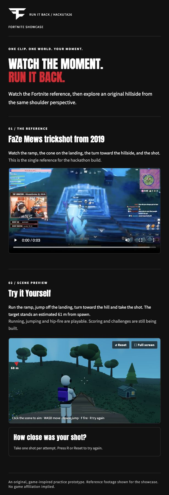
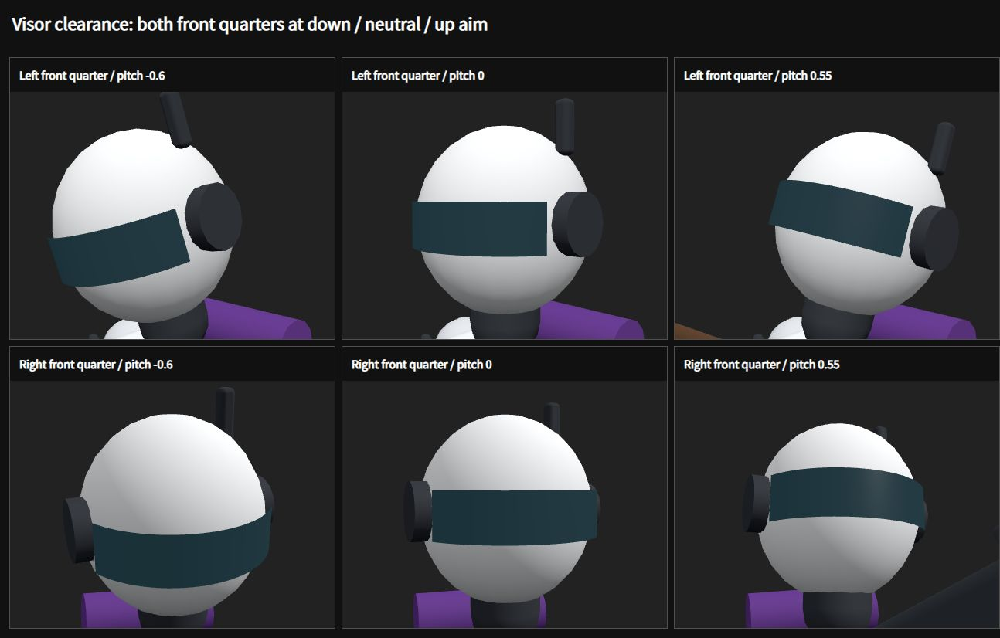

# PR #30 visor correction: release verification

**Released and verified live:** https://hackuta26.onrender.com/

- PR: https://github.com/Kx007-del/hackuta26/pull/30 (merged into `build/five-agent-h26`).
- Exact approved source: `0d18525b703f2084b28261e602f6d1fef25a5df0`.
- **Merged SHA = deployed SHA: `3222ef2c2dbb70b6b8f7a0306afd8b17db76c8c0`.**
- Render deployment: `dep-dbsnnr3bc2fs73c2qa90`, terminal state `live`.
- Public `/api/health`: HTTP 200 with `{"ok":true,"service":"run-it-back","commit":"3222ef2c2dbb70b6b8f7a0306afd8b17db76c8c0"}`. [Captured response](health.json).

## Approval, integration and exclusion

Read Codex 3's formal APPROVED review of full source head `0d18525b703f2084b28261e602f6d1fef25a5df0` before merging. That independent review specifically resolves PR #28's visor blocker and reports fresh left/right front-quarter renders at lower/neutral/upper pitch, both grips seated, plus production browser checks.

Prepared `work/codex-2/pr30-release` in Codex 2's own worktree from integration `0d6e247a62ca728b778be8970dfaa39eee2b8ad3`, then fast-forwarded to the exact approved source. The merged tree is identical to that source. No new production edits, source reset, force push or account change.

PR #29 remains OPEN at `e82664fd364eb7bdaf9886e5cd56c9d55688d0e2`. Its head is not an ancestor of the approved candidate or merged release; no community/progression code was included. Existing integration changes, prior branches and local logs were preserved.

## Checks

| Check | Result |
| --- | --- |
| `npm test` | **155/155 pass, 0 failed/skipped/todo** |
| `npm run team:test` | **9/9 pass, 0 failed/skipped/todo**, mock providers only |
| `npm run build` | TypeScript + Vite production build passed |
| `git diff --check` | Clean |
| Required GitHub checks | Both Build and tests checks passed before merge |
| Merged-commit CI | Passed |

Candidate checks: [push](https://github.com/Kx007-del/hackuta26/actions/runs/43698744092/job/132764948420), [PR](https://github.com/Kx007-del/hackuta26/actions/runs/43698747888/job/132764958791). [Merged-commit CI](https://github.com/Kx007-del/hackuta26/actions/runs/43699465957/job/132767198632).

Build: `HillsidePreview-Bx_cbdDL.js`, 550.70 kB / 146.89 kB gzip. [App test output](application-tests.log), [relay test output](relay-tests.log), [build output](production-build.log).

## Deployment

Used the existing Render web service `srv-dbsf9ujl550s738a7seg` in the previously confirmed workspace `tea-d80cdkrtqb8s7382h57g`. Its free plan, storage, source branch, build/start commands and auto-deploy setting were unchanged.

No automatic deployment/build event appeared for more than two minutes after merge despite green CI. The only live deploy still pointed to the old PR #28 merge. Triggered the missing deploy once, monitored its specific ID to `live`, and checked public health independently. No duplicate trigger or automated dispatch.

## Hosted browser checks

Freshly opened the public site after health matched the merged SHA. Used “Game data only”; the QA run did not opt into sending a gameplay video to Gemini.

- **Character/visor:** original white helmet/suit, dark helmet-side details, purple pack, arms and carried rifle render without visible shell artifacts in the production shoulder view. Captured neutral, up and down aim poses.
- **Important visibility limit:** the production camera stays behind the character and obscures most of the front visor. These hosted views are not a full front-quarter clearance proof. Codex 3 independently approved all six diagnostic front-quarter/pitch views at the exact shipped source, and the new geometry regression passes. The attributed diagnostic mosaic below is from the reviewed source, **not a hosted capture**.
- **Movement:** W held for 700 ms visibly moved the player along the ramp. Captured the changed position.
- **Firing smoke:** F registered MISS with one canvas present. Game-data-only scoring completed at 25/100 (game data 50/100, miss halving applied). No successful-hit or AI-scoring claim for this run.
- **Reset:** four consecutive resets cleared the shot/result and restored idle attempt instructions, while each observation retained exactly one canvas and the scene returned to the spawn framing. The character's idle breathing is animated, so no byte-identical screenshot claim is made.
- **Console:** no recorded browser warnings/errors through mount, aim, movement, fire and resets.

[Raw browser observations](browser-observations.json).

### Hosted screenshots

[Up aim](02-hosted-aim-up.jpg) · [Down aim](03-hosted-aim-down.jpg) · [After movement](04-hosted-after-movement.jpg) · [Fired attempt](05-hosted-fired.jpg)

### Attributed review evidence — not hosted

## Remaining limitations

Full front-quarter visor visibility is unavailable in the normal hosted shoulder camera; the direct clearance proof is the exact-head independent review and passing geometry regression, with this limitation recorded rather than overstated.

The rifle remains mostly occluded by the shoulder in the production view. Existing weapon-wall clearance and rifle/camera pitch-limit differences were not changed by the narrowly reviewed visor correction. Physical GPU performance, touch devices, real pointer lock/Escape and successful hits were not newly verified in this release run. Codex 3's independent report separately covers local real mouse capture/look/Escape and firing; that is not substituted for hosted testing.

No PR #29 changes, hosting plan/storage changes, main merge, account switch or automated dispatch.
